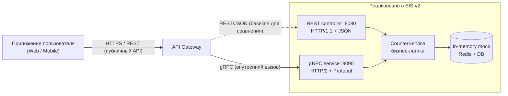
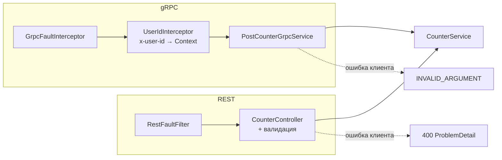
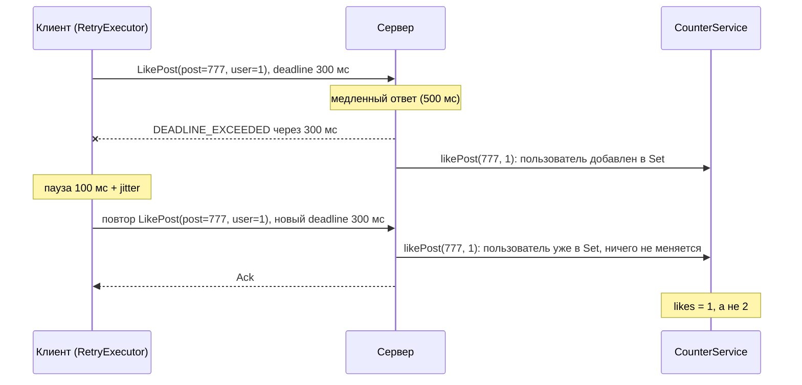
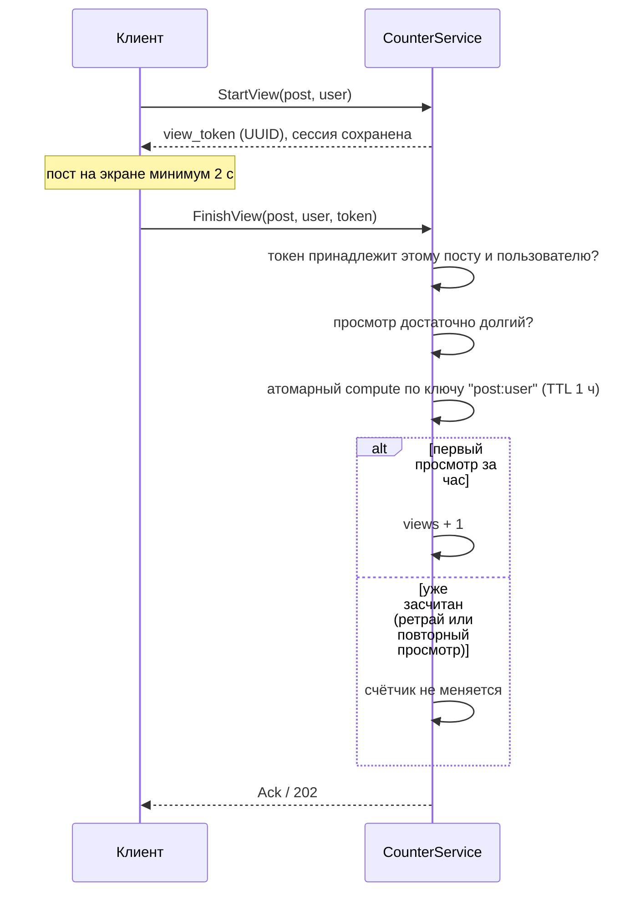
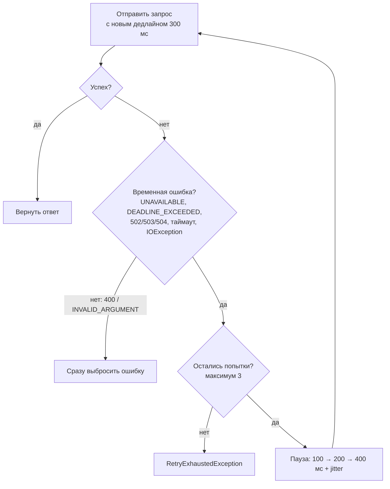

# SIS #2 — Like & View Counter: реализация протокола

Реализация сервиса из SIS #1 (Like & View Counter) на **gRPC (HTTP/2 + Protobuf)**
с идемпотентностью, таймаутами и ретраями. Для сравнения тот же сервис сделан на
**REST/JSON (HTTP/1.1)**: измерены задержка (latency) и размер payload.

**Стек:** Java 21, Spring Boot 4.1.2, gRPC-Java 1.84.0, Protobuf 4.36.2, Lombok, JUnit 5.

---

## 1. Выбор протокола: REST снаружи, gRPC внутри

В SIS #1 клиенты обращаются к API Gateway по HTTPS/REST. Протокол между Gateway и внутренними
сервисами (Write/Read Service) там не был зафиксирован. В SIS #2 REST оставлен там, где он
подходит лучше всего, а gRPC добавлен там, где его выбор подтверждают замеры.

### Публичный API (клиент → API Gateway): REST/JSON, как в SIS #1
- Браузеры и мобильные приложения поддерживают его нативно. gRPC в браузере требует gRPC-Web и прокси.
- `GET`-запросы счётчиков можно кэшировать через HTTP-кэш и CDN.
- Легко отлаживать и интегрировать: curl, devtools браузера, читаемый JSON.
- gRPC экономит лишь десятки микросекунд (см. результаты), а задержка сети интернета — десятки
  миллисекунд. На публичной стороне выигрыш не стоит дополнительной сложности.

### Внутренний вызов (API Gateway → Write/Read Service): gRPC
- Payload в Protobuf в **5–6,5 раза меньше**, чем в JSON, на данных счётчиков.
- Batch-запрос счётчиков (запрос ленты) в среднем **на ~35% быстрее**, p99 **почти в 2 раза** ниже.
- HTTP/2: одно долгоживущее соединение с мультиплексированием и сжатием заголовков (HPACK).
- Строгий контракт в `.proto` и сгенерированный код клиента и сервера: сервисы не могут разойтись в формате.
- Встроенные дедлайны (таймауты), которые передаются на сервер.
- Честная оценка масштаба: на пике 132k чтений/с ≈ 6,6k batch-запросов/с. Трафик падает с
  ~7,2 МБ/с (JSON) до ~1,3 МБ/с (Protobuf). Это полезно, но не критично. Главный выигрыш —
  более дешёвая сериализация и короткий «хвост» задержек на каждом межсервисном вызове.

### WebSocket не выбран
Серверные push-уведомления не нужны. Требование eventual consistency ≤ 2 с выполняется
обычной схемой запрос/ответ при загрузке или обновлении ленты.

---

## 2. Архитектура

Оба транспорта вызывают **один и тот же** `CounterService`. В замерах отличается только протокол.

| Пакет | Ответственность |
|---|---|
| `counter` | бизнес-логика и in-memory хранилище |
| `rest` | REST/JSON baseline (порт 8080) |
| `grpc` | gRPC-сервер (порт 9090), интерсептор `x-user-id` |
| `client` | REST- и gRPC-клиенты с таймаутами и ретраями |
| `fault` | имитация сбоев (по умолчанию выключена) для демонстрации ретраев |
| `benchmark` | замеры latency и размера payload |

### Соответствие хранилища дизайну SIS #1

| Структура в памяти | Аналог в SIS #1 |
|---|---|
| `postId → Set<userId>` | таблица `likes`, PK `(post_id, user_id)` |
| `postId → AtomicLong` | Redis `HINCRBY counter:{post_id} views` |
| `"postId:userId" → время засчитанного просмотра` (атомарный `compute`, TTL 1 ч) | Redis `SET view:{post_id}:{user_id} NX EX 3600` |
| `viewToken → (postId, userId, startedAt)` | подписанный `view_token` |

---

## 3. Диаграммы

### Контекст системы: что реализовано



### Обработка запроса на сервере



### Таймаут + ретрай + идемпотентность (лайк)



### Засчитывание просмотра



### Логика ретраев на клиенте



---

## 4. API: соответствие SIS #1 → gRPC

| REST (SIS #1) | gRPC (`post_counter.proto`) |
|---|---|
| `PUT /api/v1/posts/{id}/like` → 202 | `LikePost` → `Ack` |
| `DELETE /api/v1/posts/{id}/like` → 202 | `UnlikePost` → `Ack` |
| `POST /api/v1/posts/{id}/view_started` → `{view_token}` | `StartView` → `StartViewReply` |
| `POST /api/v1/posts/{id}/view_finished` → 202 | `FinishView` → `Ack` |
| `GET /api/v1/posts/{id}/counters` | `GetCounters` → `CountersReply` |
| `GET /api/v1/counters?post_ids=...` | `BatchGetCounters` → `BatchCountersReply` |

ID пользователя передаётся в заголовке `X-User-Id` (REST) или в metadata `x-user-id` (gRPC).
Это упрощение вместо JWT: аутентификация не входит в задание.

---

## 5. Идемпотентность, таймауты и ретраи

### Идемпотентность

| Операция | Почему повтор безопасен |
|---|---|
| Like / Unlike | Лайки — это множество (`Set`) пользователей. Повторное добавление ничего не меняет |
| FinishView | Токен **не удаляется** после использования. Ключ дедупликации `postId:userId` (TTL 1 ч) ставится атомарно через `ConcurrentHashMap.compute`, поэтому ретрай возвращает OK без второго +1 |
| StartView | Не идемпотентен (создаёт новый токен), но не меняет счётчики, поэтому повтор безвреден |
| GetCounters / Batch | Только чтение |

### Таймауты
- 300 мс на каждую попытку: в gRPC `withDeadlineAfter`, в REST `HttpClient.timeout`.
- Дедлайн выставляется **заново для каждой попытки**, иначе ретрай стартовал бы с уже истёкшим.

### Ретраи (`RetryExecutor`)
- До 3 попыток, экспоненциальная пауза 100 → 200 → 400 мс плюс случайный jitter
  (чтобы много клиентов не ретраили одновременно).
- **Повторяются** только временные ошибки: gRPC `UNAVAILABLE`, `DEADLINE_EXCEEDED`;
  REST 502/503/504, таймаут, ошибка соединения.
- **Не повторяются** ошибки клиента: `INVALID_ARGUMENT` / HTTP 400. Повтор плохого запроса даст ту же ошибку.
- Ретрай после таймаута безопасен **только потому, что операции идемпотентны**: таймаут не
  означает, что сервер не обработал запрос.

### Доказательство: тесты со сбоями

`RetryIdempotencyTest` поднимает приложение с имитацией сбоев: 20% запросов получают ошибку,
10% отвечают с задержкой 500 мс (больше таймаута 300 мс). 30 пользователей ставят лайк
дважды и дважды завершают просмотр. Результат: **ровно 30 лайков и 30 просмотров** и для REST,
и для gRPC. Ни потерь, ни дублей.

Примеры строк из лога тестов:
```
WARN RetryExecutor : grpc.likePost attempt 2/10 failed: UNAVAILABLE: Injected failure
WARN RetryExecutor : grpc.likePost attempt 1/10 failed: DEADLINE_EXCEEDED: CallOptions deadline exceeded after 0.299979083s.
WARN RetryExecutor : rest.likePost attempt 1/10 failed: HTTP 503: {"status":503,"error":"Service Unavailable","path":"/api/v1/posts/2001/like"}
WARN RetryExecutor : rest.likePost attempt 1/10 failed: request timed out
```

Тест на ошибку клиента: запрос с поддельным токеном сразу получает `INVALID_ARGUMENT` / HTTP 400, без ретраев.

Итог: `Tests run: 13, Failures: 0, Errors: 0`.

---

## 6. Результаты замеров

**Условия:** MacBook (Apple Silicon), Java 25, клиент и сервер на localhost, последовательные
запросы, 2 000 запросов прогрева + 10 000 измеряемых на каждую операцию. Сбои выключены,
ретраев во время замера 0. Данные засеяны: по 5 лайков и 5 просмотров на пост, чтобы
счётчики были ненулевые, как в реальной ленте.

### Latency (мс)

| Операция | avg | p50 | p95 | p99 |
|---|---|---|---|---|
| REST getCounters | 0.108 | 0.098 | 0.153 | 0.266 |
| gRPC getCounters | 0.088 | 0.080 | 0.127 | 0.164 |
| REST batch (20 постов) | 0.115 | 0.111 | 0.125 | 0.196 |
| gRPC batch (20 постов) | 0.075 | 0.076 | 0.088 | 0.105 |
| REST likePost | 0.074 | 0.067 | 0.089 | 0.130 |
| gRPC likePost | 0.069 | 0.070 | 0.079 | 0.093 |

### Размер payload (только тело, байты)

| Сообщение | JSON | Protobuf | JSON / Protobuf |
|---|---|---|---|
| Ответ getCounters | 52 | 8 | 6.50x |
| Ответ batch (20 постов) | 1085 | 200 | 5.43x |
| Запрос finishView | 53 | 40 | 1.33x |

### Выводы
1. **Payload.** Protobuf в 5–6,5 раза компактнее на данных счётчиков: вместо имён полей
   передаются их номера, а маленькие числа кодируются varint (1–2 байта).
2. **Строки почти не сжимаются.** На `finishView` выигрыш всего 1,33x, потому что большую часть
   сообщения занимает UUID-токен (36 символов). Protobuf выигрывает на числах и именах полей.
3. **Latency.** gRPC быстрее, заметнее всего на batch-запросе: среднее −35%, p99 почти в 2 раза
   ниже. Чем больше сообщение, тем сильнее сказывается дешёвый бинарный парсинг по сравнению с JSON.
   На `likePost` (почти без тела) разница минимальна.
4. **Масштаб.** Абсолютная разница — десятки микросекунд, потому что всё работает на localhost
   и в памяти. Поэтому для публичного API этот выигрыш не важен, и там оставлен REST. Для
   внутренних вызовов при десятках тысяч RPS он суммируется, поэтому там выбран gRPC.

### Ограничения
- Измеряется только тело сообщения. HTTP/1.1 передаёт заголовки текстом в каждом запросе, а
  HTTP/2 их сжимает, поэтому реальная разница в трафике ещё больше.
- Один поток клиента. Пропускная способность под параллельной нагрузкой не измерялась.
- Хранилище в памяти: данные теряются при перезапуске и не общие между инстансами
  (в продакшене Redis Cluster + шардированная БД, как в SIS #1).
- Один порог просмотра (2 с) вместо 20 с для видео. Старые сессии просмотра не очищаются
  (в продакшене TTL в Redis).

---

## 7. Запуск

```bash
# тесты: юнит-тесты + ретраи и идемпотентность со сбоями
./mvnw test

# сервер: REST на 8080, gRPC на 9090
./mvnw spring-boot:run -Dspring-boot.run.arguments="--counter.min-view-duration=0s"

# бенчмарк (во втором терминале, сервер должен быть запущен)
./mvnw compile exec:java -Dexec.mainClass=kz.kbtu.sisforhighload.benchmark.BenchmarkRunner
```

Ручная проверка:
```bash
# REST
curl -X PUT localhost:8080/api/v1/posts/777/like -H "X-User-Id: 1"
curl localhost:8080/api/v1/posts/777/counters -H "X-User-Id: 1"

# gRPC (нужен grpcurl: brew install grpcurl)
grpcurl -plaintext -proto src/main/proto/post_counter.proto -H 'x-user-id: 1' \
  -d '{"post_id": 777}' localhost:9090 counter.v1.PostCounter/GetCounters
```

Имитация сбоев включается в `application.yml`:
```yaml
fault:
  enabled: true
  failure-rate: 0.2
  slow-response-rate: 0.1
  slow-response-delay: 500ms
```
о